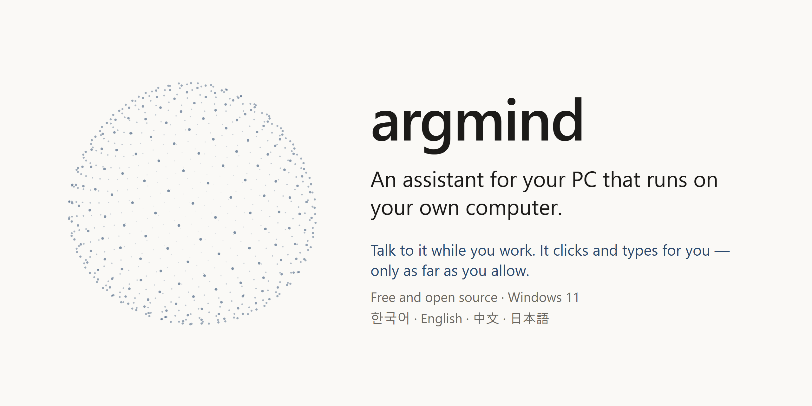

  

  
  
  
  

<!-- A 20–30 s screen recording goes here: drag the .mp4 into this file in GitHub's editor and it
     becomes a user-attachments link that plays inline. -->

# argmind

**A local-model agent you talk to while you work at your PC.** The models run on your machine
through Ollama, so what argmind reads off your screen, hears and says is not sent to a model
service. It reads the screen through the operating system's accessibility layer, talks and listens,
carries work through to the end in a folder of its own, and acts on your desktop only as far as
the switches you set allow.

A side project by one person, not a product, with no support commitment. **Windows only for now.**
The interface is in Korean, English, Chinese or Japanese: your system's language, or the one chosen
under 🌐 at the top of Settings. argmind answers in the language you write in, or always in one
of those four if you choose it under *Conversation language*, and it understands the same requests
in each of them — *remember that…*, *stop*, *open YouTube*. One thing stays
as the model wrote it: a finished task's or errand's report, which comes from a Korean prompt and
is said in Korean inside a sentence in your language, because translating it was measured changing
prices and names.

## Quick start

1. **Check the machine**: Windows 11 and a GPU with about 16 GB of memory ([Requirements](#requirements)).
2. **Download** `argmind-…-windows-x64.zip` from [Releases](https://github.com/YounghyeonPark/argmind/releases/latest),
   unzip it anywhere, and run `argmind-app.exe`. It is not code-signed, so Windows SmartScreen
   will warn the first time: *More info → Run anyway*, or [build it yourself](#build-and-run).
3. **Let it fetch what is missing.** It lists what it needs (Ollama, the models, the voice, the
   recogniser) and asks before fetching each one.
4. **Talk to it.** Type, or hold F9 in its window and speak. Until you allow otherwise in
   Settings, every action it proposes waits for you to press **Run** — see
   [Safety](#safety-what-it-may-do-and-the-defaults).

## What it does

- **Talks while you work.** Type, or hold F9 in its window and speak. A reply takes about 0.6 s
  (measured median, qwen3:8b, warm) and can be spoken in a neural voice it builds and runs on your
  GPU, falling back to the Windows voice.
- **Sees the screen as names, not pixels.** UI Automation lists what is on screen, the model picks
  one by number, and the program finds it again just before acting.
- **Acts on your desktop**: clicks, typing and keys. It goes through control patterns, or a
  message posted to the program's own window, and uses your pointer and keyboard only when neither
  works.
- **Carries work to the end.** *Write and run a script*, *summarise this into a Word file* and *fix
  the failing test* go to a task loop on qwen3:14b. The model picks one tool a step, the program
  runs it and records what came back word for word, and a claimed finish is checked against the
  files and that record before it is accepted.
  - **Tools:** files in `%USERPROFILE%\argmind-work`, commands in a WSL sandbox, PowerShell,
    Blender and KiCad through their scripting interfaces when they are installed, and MCP servers
    you configure.
  - **For programs that only have buttons:** a hidden desktop of argmind's own.
- **Has its own browser pane** inside its window, driven over DevTools with no debugging port, for
  looking things up.
- **Notices things**, such as a window change or a dialog, and may say something or offer to act.
- **Works on a goal by itself** when you have set one and nothing else is going on.
- **Optional camera senses**: *movement seen N seconds ago*, and *head facing or turned*. No
  picture is kept. Off unless you turn them on.

## The one rule

> **The deterministic side says WHERE. The probabilistic side says WHAT.
> A model never emits a coordinate.**

This was measured on this machine before any of it was written:

- **A vision model asked for a pixel** took **24–82 s**, and on a dense screen never answered.
- **UI Automation** answers the same question exactly in **41–266 ms**.

**The first of those was a reasoning model doing arithmetic.** Asked the way it was trained —
reasoning off, a box — the same family answers in **0.4–0.6 s**, measured on drawn screens on
2026-11-18. It is still less exact where the list has the thing by name (9 against 12 of 13: on a
file list it lands a row out), and it sees what the list cannot — a remote desktop, an unnamed
icon — in 5 or 6 of 6. So the rule stands on exactness, not on speed;
[docs/findings/looking.md](docs/findings/looking.md) has the numbers.

**Where the list is blind, there is now a switch, off by default**: *Find in a picture what the
list cannot see*. It works inside a place the list cannot see into, such as Character Map's grid,
where it was run in the application. A remote desktop is the same kind of place, but it was only
tried on a drawn screen, never a real one. A picture of that place goes to a vision model on your
PC, and the point it finds is kept as a fraction of the place.
- **The place, not the point.** The place is found again by name at the press, so the point moves
  with it.
- **Always a press.** Whatever it found waits for you to press **Run**, even with *Act without
  confirming* on. Under the row is the picture the model saw, with a ring where the press will
  land, so you can see a wrong cell before you press.
- **Measured.** On a real Character Map it found 8 of 10 characters, twice, and declined the one
  that was not on the page.

So the operating system supplies the names and the rectangles, and the model only ever picks a
name. That rule is enforced by tests that read the source: nothing in the core asks a model for
`x`/`y`, and nothing rendered into a prompt mentions a rectangle.

## Safety: what it may do, and the defaults

argmind presses buttons on your computer. Read this before turning things on.

- **At rest, only watching is on.** Everything below waits for your answer in Settings.
  Your answer is written to `%LOCALAPPDATA%\argmind\decisions.json`. Refusing always wins.
  - *Act without confirming*: carry out what you asked for without waiting for a press.
  - *Act on its own ideas too*: carry out argmind's own ideas as well.
  - The microphone, the camera and the voice.
  - Every install it offers.
- **Until you turn on *Act without confirming*, every action waits for a press**: it is shown as a
  row with a **Run** button.
- **The person keeps some things for themselves:**
  - **Rules, per app and per action**: *Never* or *Always ask*. The
    strictest rule wins.
  - **Passwords:** a password field is never typed into. You type it.
- **Every action is checked against the screen:**
  - It is re-resolved just before it lands.
  - A step that fails stops the steps after it.
  - A name that matches more than one control is asked about, not guessed.
  - A reply phrased as a question (*Shall I…?*) leaves its action as a row instead of running it.
- **The local server** listens on loopback only and wants a token minted each run. It refuses any
  request addressed to a host name other than this machine's, so a web page cannot reach it by
  DNS rebinding.
- **Commands a task runs** are confined, one way stronger than the other:
  - Linux commands go to a WSL distro with drive mounting and Windows interop switched off, and
    only the work folder mounted.
  - PowerShell runs on a desktop and window station of argmind's own. This is weaker: a Windows
    process is not confined to a folder.

**What it cannot promise:** a plan that is wrong but well-formed gets through. Typing into a field
that exists, on a screen that passed every check, is still typing in the wrong place. And
qwen3:8b picks the right control 21 times in 28 when there is one (below).

## What leaves the machine

**Nothing is sent to a model service.** The network is used for:

- downloading the models and installers argmind asks you about;
- building the speech recogniser and the voice server from source, at pinned commits;
- pages its browser pane opens (searches go to Naver);
- whatever commands a task runs (the sandbox has a network);
- MCP servers you configure.

**What it keeps** is in `%LOCALAPPDATA%\argmind\`, as files you can read and delete:

- settings and your answers: `decisions.json`, `devices.json`, `mind.json`, `tact.json`, `rules.json`;
- the conversation, `conversation.jsonl` (*Forget the conversation* empties it);
- handed-over errands, `errands.json`;
- the record of work it set itself, `pursuit.jsonl`;
- face prints, `faces.json`, only when you turn on recognising faces.

The activity timeline is kept in memory only and is gone at exit.

## Requirements

- **Windows 11**, which is what it is built and run on. Windows 10 is untested.
- **A GPU with about 16 GB of memory.** On an RTX 4090 Laptop (16 GB), the conversation model,
  the work model (partly on the card), the voice and the recogniser together use **12.6 GB**
  (measured). Less memory is untested.
- **[Ollama](https://ollama.com)**, which argmind offers to install.
  - `qwen3:8b` for conversation: argmind offers to pull it (about 5 GB).
  - `qwen3:14b` for work: argmind offers to pull it too (about 9 GB).
- **Rust stable, MSVC toolchain** (pinned by `rust-toolchain.toml`). The page is prebuilt in
  `ui/dist`, so building needs nothing else.
- **Optional:** the Vulkan SDK for the neural voice, and a C/C++ toolchain for the recogniser.
  `argmind check` says what is missing and what it would do about it.
- **For tasks that run code**, WSL 2. argmind then offers to make its sandbox, a distro of its own
  called `argmind-sandbox`, and asks first. It takes 1–2 minutes here and downloads about 390 MB.
  - It installs Ubuntu 24.04 from WSL's own list into `%LOCALAPPDATA%\argmind\sandbox`.
  - It writes this `/etc/wsl.conf`:

        [automount]
        enabled = false
        mountFsTab = false

        [interop]
        enabled = false
        appendWindowsPath = false

        [user]
        default = root

  - It installs `python3-docx` and `python3-openpyxl` without recommends.
  - Before calling it made, it checks that nothing of `C:` and no Windows program can be seen from
    inside. If anything is off, it removes what it made.

  Without WSL, run `wsl --install --no-distribution` in an administrator PowerShell and restart.

## Build and run

    cargo build --release --manifest-path native/Cargo.toml
    native\target\release\argmind-app.exe

`argmind-app.exe` with no arguments starts everything you have allowed. It puts an icon by the
clock and opens a window of its own. `--dry` presses nothing.

The command line, `native\target\release\argmind.exe`:

    argmind check                   what is missing, and what it offers to do about it
    argmind setup                   fetch what is missing, asking first
    argmind look                    what is on screen right now, and how long reading it took
    argmind talk                    a conversation; it clicks only with --live
    argmind say "close this window" one exchange, then exit
    argmind watch --for build       speak when something happens, unasked

**Tests** need no display, model, network, microphone or speaker:

    cargo test --manifest-path native/Cargo.toml
    git config core.hooksPath .githooks    # once per clone: the pre-commit hook runs the suite

## Measured

Every number here has its conditions beside it, and most are one run. The full record is in
`CLAUDE.md`, the project's working notebook, and in `docs/findings/`. That includes the
conclusions that were withdrawn and the ways the measuring code was wrong.

| | |
|---|---|
| choosing a control | **21 of 28** answerable goals right and **7 of 9** impossible ones declined: 28 of 37 decisions. qwen3:8b with thinking off, 4 captured windows, three repeats, the worst counted |
| crowding | a list the size of a web page breaks choosing: **22 of 28 → 3–8 of 28** at 123–900 controls |
| talking | **31 of 34** conversational turns produce no action |
| language | with a language set, **48 of 48** replies in it for Korean, English and Chinese, asked in Korean or English, on two runs. Japanese holds 11–12 of 12 only because a reply in another language is rewritten by a second call (0.75 s against 0.38 s, on 9 of 24 Korean turns and none of 12 Japanese ones), and 2 of about 20 rewrites changed the meaning. A Korean sentence you asked it to remember pulls about one reply in twelve back to Korean before the rewrite |
| a reply | **0.61 s** median |
| work | **11 of 12** tasks, no false finish. qwen3:14b with reasoning on, about 148 s a task, one run; each task checked against files and the sandbox, never against the model's own account |
| documents | Word and Excel made, changed and read: **13 of 13**, none false, one run |
| installed programs | Blender and KiCad through their scripting: **3 of 3**, against **0 of 3** without them; one run each, and later runs on a changed set read 2 of 3 and 4 of 4 |
| a covered target | with something lying over the target, neither the pattern nor the click reaches it; uncovered, both do. **24 of 24** arms as predicted before the run |

## Layout

    native/argmind-core/         the contract (Widget, Eyes, Hands), the model, the session, tasks,
                                 errands, rules. Names no platform
    native/argmind-env-windows/  UI Automation for eyes; patterns, window messages and SendInput for
                                 hands; WASAPI, SAPI, the work desktop, the sandbox
    native/argmind-env-*/        the browser pane, Ollama, Whisper, the voice, MCP, Linux eyes, and
                                 an environment that can do nothing (the proof the app is separable)
    native/argmind-serve/        the application: a local server, the page, the tray, the CLI
    native/argmind-window/       its window, the tray icon, the browser pane
    native/argmind-rules/        rules the repository keeps by reading its own source
    native/argmind-measure/      every harness behind the numbers
    ui/                          the page, TypeScript with no dependency but tsc
    measure/                     goals, captured screens, and every recorded answer

## History

Until 2026-09-09 this name meant a recursive-least-squares library for on-device adaptation,
ported to C++ for Cortex-M. That tree was removed rather than left unused. It is intact under the
tags `before-removal-2026-09-09` and `argmind-v1`, and `REBUILD.md` says why. Until 2026-09-15 the
agent was Python. That tree is at `python-before-removal-2026-09-15`, and what it produced is
committed as data so the equivalence checks outlived it.

## Licence

Apache-2.0. See `LICENSE` and `NOTICE`, which also asks that the numbers be quoted with their
conditions. Every dependency's licence is recorded in `docs/licences.toml` and checked by a test.
The notices of the third-party code built into the executables are in `THIRD-PARTY-NOTICES.txt`,
which a release carries and a test keeps in step with the dependency graph.
Author: Younghyeon Park.
